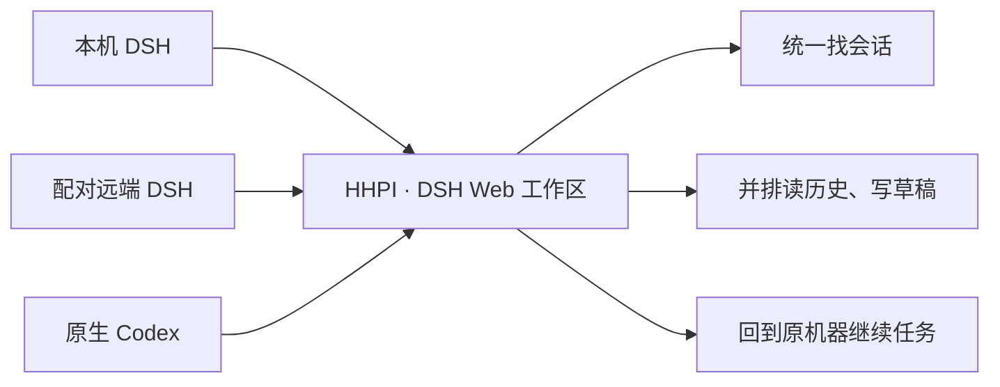

# HHPI · 把各台机器上的 Agent，放进一个 DSH 工作区

**Your agents, across machines. One DSH workspace.**

工作站上的 Codex 还在跑，另一台机器的 DSH 已经有了结果，本机还有一份没写完的草稿。打开 HHPI，在同一个侧栏找到它们，分屏查看、继续对话，直接回到对应机器处理文件和终端。

HHPI 是 [DeepSeek Harness](https://github.com/deepseek-ai/deepseek-harness) 的 Web 工作区插件，接入**本机 DSH、配对远端 DSH 与原生 Codex**。界面沿用官方 DSH Conversation、编辑器和插件扩展点；任务、工具、队列与审批继续由原来源管理。

[快速上手](#快速上手) · [来源与能力](#来源与能力) · [架构](docs/architecture.md) · [参与开发](#参与开发)

## 从找到会话，到继续工作

1. **找到正在做的事。** 在统一侧栏搜索跨机器会话，打开已有任务，查看历史与最新进展。
2. **把上下文摆在一起。** 用窗口组织不同项目，用分屏并排读两段对话；每个窗格独立阅读、编辑自己的草稿。
3. **在原来源继续。** 在对应会话中输入、选择模型、处理审批；来源提供相应能力时，打开源文件、预览附件或使用终端。关闭窗格只释放视图，任务仍由原执行端管理。



## 一个入口，保留各自的工作上下文

- **跨机器组织任务。** 同一侧栏、多个窗口、可调整的分屏，让本机与远端会话放在一起工作。
- **长对话也能接着读。** 历史分页、实时更新与消息定位进入同一个官方读者；各窗格独立阅读，草稿和附件按账号与来源隔离。
- **熟悉的 DSH 体验。** 使用官方聊天、编辑器、文件预览和终端组件，通过公开 provider 与 slot 接入来源能力。
- **操作回到正确的机器。** 会话身份、执行权限和资源归属贯穿文件、上传、终端及原生操作；源端继续负责工具执行与最终审批。

会话还可以分享、导出，并通过账号级服务同步已读与通知。模型、权限、队列、计划和 Goal 等操作会随当前来源能力提供，详见[原生 Codex 使用指南](docs/native-codex.md)。

## 来源与能力

| 来源 | 你接入的是什么 | 执行与资源归属 |
| --- | --- | --- |
| 本机 DSH | 当前 Host 的官方会话与 provider | 当前 DSH Host |
| 配对远端 DSH | 另一台 Host/Runner 的官方会话、事件与插件图 | 原 DSH 机器 |
| 原生 Codex | 原机器的 app-server、原生 thread 与历史 | 原 Codex 执行端；文件、上传和 PTY 由显式配置的源 OS owner 提供 |

可用操作由来源实际声明的能力决定。插件若直接访问本机进程或私有 Agent 状态，需要适配对应来源。其他 Agent 可通过源适配器扩展，当前已接入范围以上述三条为准。

接入说明：[远端 DSH 配对](docs/install.md#配对-dsh-runner) · [原生 Codex 接入](docs/hhpi-native-attachment.md) · [资源与权限架构](docs/architecture.md)

## 快速上手

**访问已有工作区：** 用浏览器打开管理员提供的受信任入口即可，无需在浏览器所在机器安装 HHPI。

**自建工作区：** 使用维护者提供的完整 `hapi-dsh-bundle-VERSION.tgz`。运行环境为 **Node.js 24.x、DSH `0.2.2-rc.1`、`pnpm@11.28.5`**；Host 与每个 Runner 使用同一 bundle 的完整扩展集合。安装需要联网。

以下命令用于首次安装；已有实例请保留原配置、机器身份与 profile，按[升级流程](docs/distribution.md)更新。

```text
npm install --global pnpm@11.28.5 @deepseek-ai/dsh@0.2.2-rc.1
tar -xzf hapi-dsh-bundle-VERSION.tgz
node package/dist/install.mjs install --profile hapi --role host
```

将 `VERSION` 换成取得的 bundle 文件名。安装器会打印受管 release 目录；把下方 `RELEASE` 换成这个实际路径，再初始化并启动：

```text
node "RELEASE/runtime/node_modules/hapi-dsh/dist/cli.js" init --config-only
node "RELEASE/runtime/node_modules/hapi-dsh/dist/cli.js" doctor
node "RELEASE/runtime/node_modules/hapi-dsh/dist/cli.js" start
```

默认入口为 `127.0.0.1:3080`，使用官方 DSH 打印的登录链接进入。技术包名和命令仍为 `hapi-dsh`，远端插件名为 `hapi-dsh-runner`。

完整 bundle 包含 HHPI 与匹配的 DSH 源码扩展；单独的插件 tgz 或普通 npm 同名 rc 不能替代这套安装。

- **[完整快速指南](QUICKSTART.md)**：安装、登录、接入机器与升级。
- **[安装与运行](docs/install.md)**：配置、配对、现有 DSH Web 挂载。
- **[分发与回滚](docs/distribution.md)**：bundle、源码、版本核对及恢复。

## 常用快捷键

先按 `Ctrl B`，再按对应按键：

| 按键 | 操作 |
| --- | --- |
| `%` / `"` | 左右 / 上下分屏 |
| `c` / `x` / `z` | 新建窗口 / 关闭窗格 / 放大窗格 |
| 方向键 / `o` | 移动焦点 / 下一个窗格 |
| `n` / `p` / `1`–`9` | 切换窗口 |
| `u` / `?` | 恢复关闭窗口 / 查看快捷键 |

## 参与开发

欢迎通过 [Issues](https://github.com/dqtz5vpvj9-create/hapi-dsh/issues) 提交使用反馈，或通过 [Pull requests](https://github.com/dqtz5vpvj9-create/hapi-dsh/pulls) 参与来源适配、工作区交互和原生能力接入。

开始前阅读 [AGENTS.md](AGENTS.md) 与[当前架构](docs/architecture.md)。本地开发按以下顺序准备：

1. **安装依赖与完整 DSH 扩展。** 先执行 `npm ci`，再按照[源码扩展指南](docs/hhpi-extension-install.md#从源码准备构建和安装)完成扩展的准备、构建与安装。每次 `npm ci` 会还原原版依赖，之后都须重新安装完整扩展。
2. **执行测试与完整检查。** 扩展安装完成后，再运行：

```text
npm run test:changed
npm run check
```

[测试说明](docs/testing.md)介绍针对性测试与发布检查；[扩展安装](docs/hhpi-extension-install.md)说明固定 DSH 扩展的源码、构建与版本归档。HHPI 正在持续开发，具体发行与验证范围以对应 bundle 为准；[运行入口变更记录](docs/hhpi-retirement-release-notes.md)保留此前发布快照。

## 许可与来源

HHPI 采用 [AGPL-3.0-only](LICENSE)。项目复用了 HAPI 的部分工作区、输入和兼容实现，保留原作者与来源声明；DeepSeek Harness 源码采用 MIT 许可。对应 DSH 扩展的补丁、完整源码和许可随发行提供。

具体来源、固定版本与许可见 [UPSTREAMS.json](UPSTREAMS.json)、[NOTICE](NOTICE) 和[许可目录](docs/licenses)。
