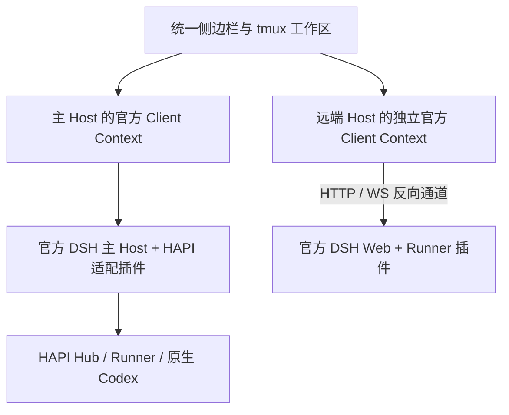

# 架构与扩展边界

## 统一工作区与会话归属

侧边栏聚合所有已知目录，资源身份同时包含 Host 身份和原始会话 ID。同名、同 ID 的不同机器会话不会相互覆盖。窗格从资源身份找到正确 Host，再 retain 该 Host 的会话引用。关闭窗格释放引用，不把关闭视图转换成取消任务或终止引擎。

远端不会被嵌入成 iframe 或整套机器页面。浏览器为每个远端建立独立的官方 `ClientModuleSystem`、Loader 和 Cordis Context，加载该 Host 的插件图，渲染属于该 Context 的官方会话 UI。工作区负责组合窗格；Session、模型、Remote schema 和插件工厂各自保留所属 Context 的运行环境。

## 为什么要独立 Context

官方 Client 的 connection、remote `$host`、会话目录和插件依赖图都属于一个 Context。把多台 Host 的对象塞进同一个 Context，会错误地共享机器级 API、schema 和 provider。单纯改一个代理 base URL 也不能给所有第三方插件补全这些归属关系。

这里保留官方的 Context 边界，再在外部聚合目录与布局。远端 Runner 运行完整官方 Web profile，因此 API、WebSocket 事件及审批都经过原来的 Host 路由。没有用仅能表达部分对话操作的 SDK 模拟完整 Web Host。

## 官方插件入口

| 层 | 本项目的扩展点 | 保留的官方实现 |
| --- | --- | --- |
| Host | 普通 Cordis `apply`、公开 services 和 Typert Remote 注册 | loader、Session、agents、attachments、WebServer、connection |
| 主 Client | `main` 与 `sidebar.workspaces` slots，工作区 controller | 官方 shell、设置、插件页面、Conversation 工厂 |
| 原生 Codex | 注册原生 agent，投影 Session 事件与内容 | 官方 Conversation / Message / Tool / Artifact 展示机制 |
| 远端 Client | 官方模块图、Loader bootstrap、可注入连接 transport | 原始插件 bundle 与所属机器服务绑定 |
| 机器接入 | `webServer.register` / `registerUpgrade`，官方请求准入 | 官方 Cookie、Host/Origin 策略、原始 API 与事件协议 |
| 分发 | `dsh.bundle.patch`、`dsh.client`、官方 profile/plugin CLI | 上游安装、配置合成和插件生命周期 |

源代码入口是 `src/index.ts`、`src/client/index.ts`、`src/runner/index.ts`。`config/cordis.patch.yml` 只把私有配置文件路径传给 Host。Runner 使用独立 manifest，防止根 Client 插件意外出现在每台远端图中。

主 profile 通过普通 provider 行替换使用 `hapi-dsh/session-controller`。它继承官方 SessionController 的 schema、依赖和全部普通 DSH 操作，只为原生 Codex 拒绝会产生假成功的模型切换/分支及不适用的通用队列操作，并将原生重命名送回 HAPI。没有修改官方类原型或源码。

浏览器 bundle 是官方模块注册格式，Host bundle 是 ESM。它们不是可以直接插入任意网页的通用脚本。构建与 manifest 契约见[分发文档](distribution.md)。

## 原生 Codex 的执行与投影

HAPI 保存原生 thread 身份和实际执行归属，原生 app-server 继续拥有 turn、工具调用、审批和队列。插件将 HAPI 的原生事实转换成 DSH Session 事件与内容块，并把输入、取消、steer、恢复和审批答案送回原生桥。

展示进度与投递确认分开保存：请求发送到网络并不意味着原生系统已经最终接收，审批答案 HTTP 成功也不等于审批已经最终解决。原生事件或队列状态用于确认结果；不确定状态保留给用户显式处理。原生 history rewind 更换展示代次，稳定的逻辑会话身份继续定位原有窗格。

需要配置 native Codex 的真实机器、工作目录、home 与模型时，UI 查询 HAPI Runner 的能力。适配器不会把本机 DSH provider 当作 Codex 的实际推理引擎，也不会把不存在的远端能力显示为成功。

官方聊天展示、工作区和 Host/Client 插件机制可以复用，但执行引擎的扩展仍有归属。依赖 DSH `AgentLoop` 的工具执行、上下文维护或系统提示扩展，不会自动成为原生 Codex 的执行能力；这些行为需要 Codex 原生扩展或 HAPI 桥提供对应契约。原生适配器对没有契约的控制明确拒绝。空的 Codex thread 也直接使用官方嵌入式 composer，工作目录由其原生 Runner 所有，不要求在主 DSH Host 上另建同一路径的 Workspace。

原生控制分别保留持久回执，不能把一次网络响应统一解释为“任务完成”：

| 控制 | 原生确认依据 | 断线或重启后的行为 |
| --- | --- | --- |
| 新建 | HAPI 的持久 `requestId` claim、原生 thread 与机器/home 元数据 | 已知 source session 后只读取并 attach；未知来源的明确 reconcile 才用同一原始 requestId 恢复上游回执 |
| 设置 | 上游等待的设置通知，或随后读到的实际值 | `confirmed` / `observed` 与 `indeterminate` 分开；后者只观察，不自动再次写入 |
| 分支 | UUID、源 revision、真正 native 边界及上游 fork receipt | read/reconcile 读取原操作；只有原生 child binding ready 才 attach；创建新操作需显式处理重复风险 |
| 执行计划 | 源公布的 proposal ID 及 `${planId}:implement` 的原生队列事实 | `submitted` 只表示提交被接收，`queued` / `invoked` 来自原生队列；同一未确定提案不能换 UUID 绕过保护 |

分支的 DSH display message ID 先映射到已提交的 native `threadId/turnId/itemId`，不把展示 ID 当作 HAPI local ID。计划执行使用原生 `/codex/plan/implement`，切换模式与是否可入队由原生 owner 决定。关闭视图不执行中断；用户主动取消仍走原生 abort。

原生历史 seed 的辅助记录使用 `displayTurn/displayStep`。官方 Conversation 会将所有事件 payload 顶层的 `turn/step` 视作真实位置；辅助字段不能制造额外步骤，也不能改变最终回答所在的边界。这一契约由已发布的官方 `ConversationNodeAssembler` 回归验证。

## 反向通道

Runner 通过私有配对凭据发起 WSS 连接。握手验证协议版本、稳定机器 ID 与精确 DSH 版本，同一身份只允许一个在线实例。Hub 保存摘要，Runner 保存原始机器凭据。

浏览器访问机器 API 先通过主 Host 的官方认证。Hub 删除浏览器 Cookie、Authorization、Origin 和代理相关头；Runner 使用自己的内存内官方 Cookie 访问仅绑定回环的官方 listener。响应不会把远端 Cookie 带回主浏览器。请求路径、HTTP 字节及 WebSocket 文本/二进制消息继续交给官方 Host 解释。

WebSocket 握手等待远端插件选择 subprotocol 后再向浏览器确认，避免代理擅自选择不同协议。HTTP 按块传输与确认，流量持续时刷新空闲超时；通道数量、帧大小与缓冲量有上限。

连接丢失会中止当前 HTTP 与 WebSocket 通道，主机标记离线。重新建立的是传输连接，不重放曾经发送的 mutations。若操作在断线前已经执行而响应丢失，调用方必须重新读取原系统状态或显式处理不确定结果。

## Bootstrap 与插件能力边界

`/hapi-dsh/bootstrap` 由 Runner 普通 Host 插件注册，并使用官方 connection 准入。响应包含精确 DSH 版本、原始 `clientModules.graph()`，以及允许列表内的安全 UI globals。它不转发任意 index HTML 或脚本 injection。

HTTP/WS 的完整通道使官方插件保留所属 Host 的 API 与事件能力，但不等于每个第三方插件都已经通过远端兼容认证。依赖任意 document 注入、顶层页面导航、固定根路径或共享 window 单例的插件仍需逐个验证。标准模块注册、官方会话组件和公开 transport 机制是本版本实际覆盖的范围；支持矩阵不应承诺未运行的第三方插件。

已配对 Runner 的插件代码与主 Host 插件同属使用者信任的执行环境。Context 隔离用于保证服务和身份归属，不是运行不可信 JavaScript 的安全沙箱。面向互不信任使用者的租户隔离不在本项目当前模型内。

官方 store 是 Web 平台内置模块，直接共享它会让其 `localStorage` 闭包跨 Host 写入同名持久键。本插件构建时从固定 npm 版本原样编译该 store 及依赖，在每个 graph 的存储命名空间内单独求值；原始插件实现不变。双 graph 的同名键、清理与重建恢复有回归测试，随安装包保留相关 MIT 许可证。

## 布局持久化

窗格几何和窗口行为从固定 HAPI 提交适配，保留 tmux 风格操作与本地恢复。服务端布局使用主 DSH profile 内的 CAS 文档存储，版本冲突显式展示。HAPI 原有 workspace API 对其原生 ID namespace 的限制不被绕过；包含 DSH 与远端 Host 资源的布局存放在本插件自己的仓库中。

## 上游依据

- [官方 Web bundle 与启动配置](https://github.com/deepseek-ai/deepseek-harness/tree/687f282e8625c6b8d11ff58211a90524be2e4317/packages/bundle/web-app)
- [官方 Client connection](https://github.com/deepseek-ai/deepseek-harness/tree/687f282e8625c6b8d11ff58211a90524be2e4317/packages/client/connection)
- [固定 HAPI fork](https://github.com/dqtz5vpvj9-create/hapi/tree/0f8ef6970884c92fb2ddca3070be2ec56cb50333)
- 本仓库 `tests/federation-official.test.ts` 通过固定 npm 发行版实际验证官方安装、插件图、原始 Conversation bundle、Session RPC 与事件 WebSocket。
