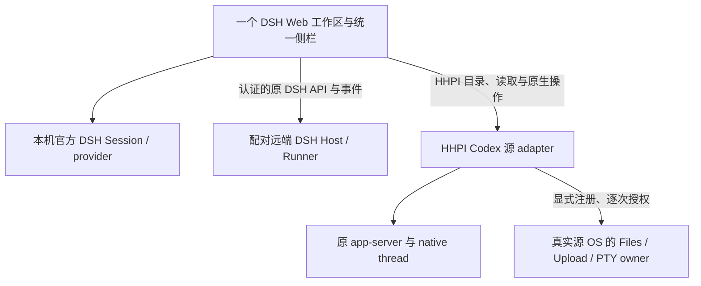

# 当前 HHPI 架构与扩展边界

HHPI 是 DSH Web 的跨机器 Agent 接入与工作区插件。当前实现包含本机普通 DSH、配对远端 DSH、HHPI Codex 三条路径。旧 HAPI Hub 运行时、观察代理和 display 执行已退休；HAPI 来源声明及离线迁移材料保留。其他引擎的适配接口不代表已有实现。

## 身份、权限与执行归属

资源首先定位所属 Host，再定位原会话。HHPI ID 编码 machine/source/engine/nativeId；联邦外层 Host 路由与内部原生身份分别保存。修改 Host 路由不重编原生身份，子 thread 也不继承父 thread 的 ID。未知或旧 display ID 明确拒绝，不回落到本机 Session、文件或 PTY。

普通 DSH 沿用原 Host 的官方 API、Invocation、权限和取消信号。公开组合 provider 通过隔离服务委托原实现；HHPI 路径不构造假 `Agent.ctx` 或借一个本地执行 Agent。服务器在每次操作和资源访问时复核授权，客户端可用性检查不替代最终裁决。

Codex 的 app-server 继续拥有 turn、工具、审批、队列与设置。读取历史不 resume，关闭 Pane 只释放视图。显式操作保留 operation ID、原生目标与不确定结果；断线、刷新和恢复不自动重发可能已经执行的写请求。

源 workspace owner 以稳定 lifetime、真实 cwd、该 OS 用户的 FileSystem/subprocess 组合 Files、上传和 Terminal。请求取消不等于 owner 生命周期结束；Pane 关闭不终止 PTY。只有明确的终端关闭动作才调用实际 owner 的关闭契约。中央 RPC bridge 不能获得另一台 OS 的资源所有权。

## 官方 DSH 读者与插件图

聊天使用官方 Conversation、Chat、编辑器、SlotRenderer 和公开 SessionBinding。工作区管理窗口、焦点、几何与视图租约，不实现第二套通用聊天渲染器。当前共享路径按 Host 复用官方 Client graph，每个 Pane 是显式 reading occurrence；仍需独立上下文的资源/插件视图保留正确的所属 Host 边界，不把整台机器作为 iframe。

源端一次分配稳定 Session 事件与 seq。浏览器共享已接受的条目，各 Pane 维护自己的有界阅读窗口、导航及取消。历史和实时在同一版本上合并；源修订撤销旧响应，普通补页不制造重连或新的执行。发布窗口通过官方 window commit 和 mounted reader 完成；逐节点 render proof 用于判定真实正文提交。

阅读水位只在实际官方读者提交后推进，不根据焦点、数据取回或目录更新时间推断已读。受控更新先调用官方 `checkpointReading` 保存实际位置，再 flush 检查点；普通重开仍默认最近窗口，恢复 ticket 只用于那次受控更新。像素偏移恢复不属于当前承诺。

公共扩展以源码补丁和官方编译交付，包含阅读 occurrence、结构化输入、文件上传 owner、通用终端 owner 与原子文件提交能力；默认普通 DSH 路径保留。版本、ADR、契约、补丁和上游 PR 草稿见[扩展安装](hhpi-extension-install.md)。不在运行时改写上游类、bundle 或原型。

## 文件、附件与终端

Workspace route 携带源与资源作用域。源注册明确提供 Files、uploads、PTY 能力；缺少某项能力就保持不可用。文件路径只由真实源 OS 解释，不尝试中央同名路径。普通 DSH 和配对 DSH 继续委托各自公开 provider。

源保存和二进制上传复用正式 FileSystem 原子写入，发布前复核权限与版本；Windows 路径保留官方 DACL/ReplaceFile 行为。上传准备完成并持久保存原始 File/Blob 后才传输。取消、迟到结果、换账号或换 binding 不得清空另一份草稿或把附件送给另一会话。

官方 TerminalController 的公开 owner 工厂组合真实 subprocess，客户端继续使用官方 ClientTerminals/body。输出保留独立于 Pane，释放 stream retain 不退出进程。旧 HAPI SessionTerminal 不再提供 attach-or-create 兼容运行时；迁移只对本安装实际引用的旧 owner 核对退出或明确无对象，不能强停无关终端。

## 账号级服务与本地状态

通知、阅读水位、分享和导出属于独立应用服务，账号 scope 包含固定 Host account、public origin 与 authenticated principal。原生源级 attention feed 不依赖打开 Pane 或逐页读正文；每个通知目标仍复核源权限。Push 能力和前台通知分别处理，缺少浏览器/设备支持时保持明确状态。

JSON 导出保留源事件，Markdown 使用可读用户/助手正文、工具摘要和源引用，图片字节留在外部资源。分享定位原来源，不自动发送、不复制执行 owner，也不额外授予权限。

草稿、附件、文档脏稿、阅读位置和布局各有实际 owner。更新准备依次 capture、冻结 revision、保存、验证，全部成功且 worker 激活完成后才 arm/reload；存储失败或期间变化保留当前页面。旧无账号数据仅提供明确的本机恢复/离线导出，不能按新登录身份自动呈现。

本机语音复用同一官方输入 owner 与排他 claim，只插入草稿，不自动发送。安全能力探测限制在明确支持本地 SpeechRecognition 的桌面浏览器；没有云端回退，Android 实验路径不启用。

## 维护边界与证据

Host、Client、Runner 入口分别是 `src/index.ts`、`src/client/index.ts`、`src/runner/index.ts`。官方 plugin/profile 管理仍负责依赖与注册；技术包名、数据目录和公开技术标识暂不改名。[安装](install.md)、[分发](distribution.md)和[测试](testing.md)说明对应流程。

源码和契约完成不等于整项交付。Windows 原源 Runner/真实 FS与PTY、真机输入/通知、最终 bundle 的全量检查和同版发布仍需各自证据。旧测量、旧 rc 安装与历史站点记录保留于[旧架构记录](archive/architecture-before-hhpi-retirement-20261107.md)，不能用于证明当前产物已通过。
