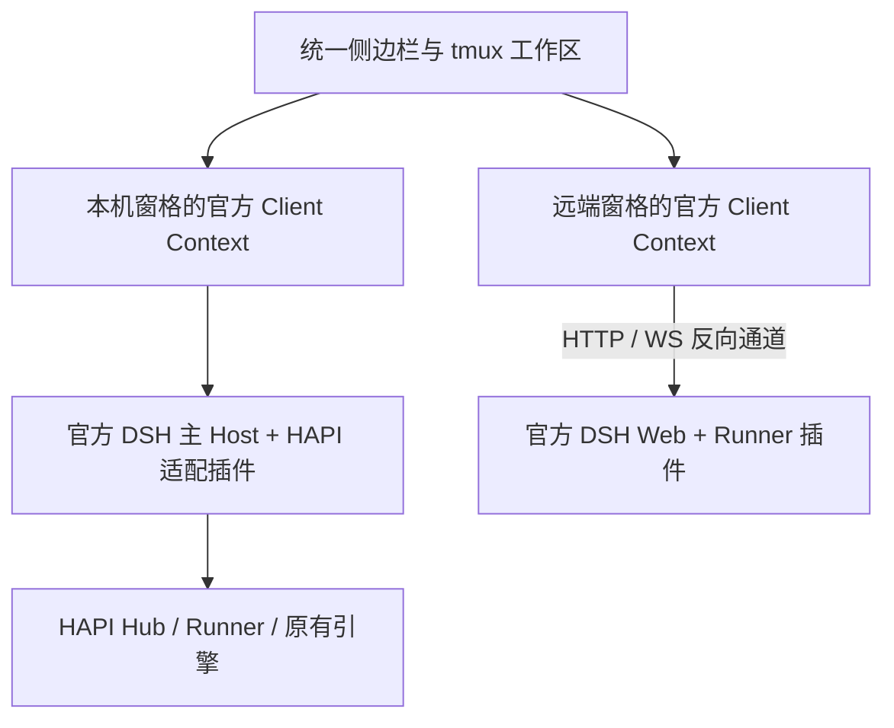

# 架构与扩展边界

## 统一工作区与会话归属

侧边栏聚合所有已知目录，资源身份同时包含 Host 身份和原始会话 ID。同名、同 ID 的不同机器会话不会相互覆盖。窗格从资源身份找到正确 Host，再 retain 该 Host 的会话引用。关闭窗格释放引用，不把关闭视图转换成取消任务或终止引擎。

远端不会被嵌入成 iframe 或整套机器页面。每个窗格拥有独立的官方 `ClientModuleSystem`、Loader 和 Cordis Context，加载所属 Host 的原始插件图；本机窗格也走同一条加载链。官方 AppFrame、Conversation、右栏、设置和插件页面均在这个 Context 中运行。目录由工作区聚合；Session、模型、Remote schema、插件工厂和右栏 TabOccurrence 保留所属 Context 的运行环境。

独立到窗格是为了保留官方插件的单个活动会话、右栏导航和对话框状态。把同一个官方 AppFrame 同时渲染两次，会错误共享这些状态。相应成本是更多 Client 对象和内存；已经共享模块加载与每个 Host 的插件更新连接，但不会为节约对象而让两个窗格共用会话焦点。

## 为什么要独立 Context

官方 Client 的 connection、remote `$host`、会话目录和插件依赖图都属于一个 Context。把多台 Host 的对象塞进同一个 Context，会错误地共享机器级 API、schema 和 provider。单纯改一个代理 base URL 也不能给所有第三方插件补全这些归属关系。

这里保留官方的 Context 边界，再在外部聚合目录与布局。远端 Runner 运行完整官方 Web profile，因此 API、WebSocket 事件及审批都经过原来的 Host 路由。没有用仅能表达部分对话操作的 SDK 模拟完整 Web Host。

## 官方插件入口

| 层 | 本项目的扩展点 | 保留的官方实现 |
| --- | --- | --- |
| Host | 普通 Cordis `apply`、公开 services 和 Typert Remote 注册 | loader、Session、agents、attachments、WebServer、connection |
| 主 Client | `main` 与 `sidebar.workspaces` slots，工作区 controller | 官方 shell、设置与插件页面 |
| HAPI 引擎 | 注册原生 Codex 或源引擎 observer Agent，投影 Session 事件与内容 | 官方 Conversation / Message / Tool / Attachment 展示机制 |
| 窗格 Client | 官方模块图、Loader bootstrap、可注入连接 transport、增量 `shell.overlay` bridge | 完整官方 `main → ConversationRoot`、原始 bundle、头部及其插件子树 |
| 文件、引用与终端 | 公开 WorkspaceFiles / FileReferenceService / TerminalController provider | 官方 Files 树、`@文件` 菜单、DocumentPreview、Terminal 视图 |
| HAPI 专有操作 | 公开 sidebarRightTabs 与 slots | 官方 tab、资源、布局、保留和导航机制 |
| 机器接入 | `webServer.register` / `registerUpgrade`，官方请求准入 | 官方 Cookie、Host/Origin 策略、原始 API 与事件协议 |
| 分发 | `dsh.bundle.patch`、`dsh.client`、官方 profile/plugin CLI | 上游安装、配置合成和插件生命周期 |

源代码入口是 `src/index.ts`、`src/client/index.ts`、`src/runner/index.ts`。`config/cordis.patch.yml` 通过普通 profile 配置注册 HAPI 服务，并组合会话、文件、文件引用、终端和子代理五个公开 provider。Runner 使用独立 manifest，防止根 Client 插件意外出现在每台远端图中。

五个官方 package-root Loader 行保持启用，通过公开的 `isolate` 隔离 Host 服务；新增组合 provider 在全局服务位置分流。官方构造器只执行一次，继续提供原 Client 模块、Typert 契约、资源注册与用户配置。不能通过 include patch 的 `name` 字段给原行改名：官方把该字段用作匹配条件；也不能禁用原 package-root 后期待其 Client 模块仍会被发现。

组合 provider 通过当前请求的 Context 查找隔离原服务，普通 DSH 请求明确委托原实现，保留原 Invocation、用户授权和流取消信号。源会话的模型、分支、队列等操作走 HAPI 原契约，避免界面出现虚假的 DSH 控制成功；文件与终端按当前 source Hub、session 和 machine 分流。没有改写官方类原型、插件图、模块 bundle 或 upstream 源码。

浏览器 bundle 是官方模块注册格式，Host bundle 是 ESM。它们不是可以直接插入任意网页的通用脚本。构建与 manifest 契约见[分发文档](distribution.md)。

## 工作区如何承载文件、终端及其他插件

工作区保存一个视图的宿主、会话身份、资源地址或 tab/panel kind、导航参数与窗格几何。视图内容交给官方 SlotRenderer 和 TabDomain。插件可以通过公开的 `hapiWorkspacePane` 打开资源、tab 或 panel，也可以把现有右栏 tab 打开成独立窗格。它观察的是自己的可见性、焦点和生命周期，不能通过 DOM 猜测全局“当前会话”。

| 责任 | 所属层 |
| --- | --- |
| 统一会话列表、窗口、分屏、焦点、缩放、移动与恢复 | HAPI 工作区插件 |
| 文件树、文档解析与预览、终端渲染 | 对应的官方 DSH 插件 |
| 文件实际读取与写入、PTY 实际执行 | 会话所属的原 HAPI Runner，或普通 DSH Host |
| 文件变化、终端保留、输入和关闭 | 原 provider 的公开契约及源协议适配 |
| 备忘录、原始历史导出、原生账号和会话操作 | 普通 HAPI 能力插件 tab |

HAPI 文件路径只在经确认的源机器上解释。原官方“在 Host 应用中打开”的动作只有路径参数，没有 source machine 参数，因此不能直接用于 HAPI 会话。源路径动作通过公开 slot 改为源文件下载；普通 DSH 路径仍交原动作处理。尚未绑定或已被替换的源会话明确失败，不会回落到 Hub 的同名文件。

终端复用官方 TerminalController 的完整接口。源端 PTY 身份、输出序号及控制租约通过原 HAPI Socket.IO 协议保存；刷新页面、移动或关闭窗格只结束视图保留。用户明确关闭终端才发送源端终止命令，输入丢失回执时不会自动重放。

第三方插件若使用这些 Session、资源及 provider 契约，可以沿用同样的窗格模型。直接访问 Host 文件系统、启动 Host 进程、改变顶层页面或依赖 DSH AgentLoop 内部执行的插件，需要对应的源适配，不能因“它是插件”就推断其操作已在远端执行。

旧 HAPI schemaVersion 2 的 SessionTerminal 与新 machine TerminalHost 属于不同源协议。导入的旧 terminal ID 继续走 `legacy-session-terminal.tsx` 的兼容视图，关闭仍只 detach；不能把旧 ID 当成新 shell 的 ID，否则会丢掉正在运行的进程。这是明确保留的兼容边界。重复的 NativeFiles/NativeDocument 已移除，文件与文档资源统一进入官方视图。

### 编辑状态、附件与工作区更新

布局只持久化导航身份和几何，不保存别的插件的私有 store。已打开编辑器可以在公开 `hapiWorkspacePane.updates` 或共享 `hapiWorkspaceUi.updates` 上注册保存准备，以及保存后的验证回调。工作区更新先执行所有准备，再执行所有验证；存储失败、编辑器变化或插件超时都会保留当前页面。原官方 store 的写入仍由官方实现完成，工作区的 Storage 容器只核验它收到的写入是否实际保存，不读取或修改私有序列化格式。

源文件编辑器把正文、原始 hash 基线和未知保存结果保存到浏览器 IndexedDB。写入源文件前先完成本地检查点；跨浏览器窗口用 revision CAS 保护，两份草稿冲突时提供对比、下载及明确选择。它不会把旧 `expectedHash` 自动换成新源文件的 hash。

聊天附件使用官方公开附件 owner callbacks 保留原 File/Blob。恢复定位到精确 Host、pane 和源会话；正文相符且没有待处理提交时才自动恢复未发送的附件。官方 `pendingSubmissions` 会在正文发送时先清空输入框，因此空附件栏不能被直接解释为“用户删除了附件”。未确定的副本保留供核对，只有精确的 `rpcId` 在公开源历史或队列中出现才可清理相应提交副本；不会按相同文本猜测确认，也不会自动发送。正文仍由原官方 semantic draft store 保存，reference chips 不被重新拼成伪造文档。

这些能力通过普通 HAPI 插件贡献到官方 slots；原文件、终端和 composer owner 保持原来的服务接口。第三方有私有编辑状态时，应主动接入更新准备回调；只加载它的 UI 并不能证明它自己的未保存内容已经持久化。

### 完整会话树与空源会话

每个窗格保留官方 `main → ConversationRoot`。早期只调用公开 `conversation.content` 工厂的嵌入方式会漏掉头部，进而丢失 `conversation.session.header.utilities` 等第三方贡献；当前组合取消了该窗格级替换。视图路由 bridge 挂在增量 `shell.overlay`，保留真实 `SessionProvider` 与原 rightbar store；原生状态、审批和队列控件只注册到 `conversation.input.dock`。不拦截另一插件的 `slots.register`，不重新声明已经归官方头部所有的子插槽。

官方空会话通常以本地 Workspace 作为输入准入依据，而源 Runner 的目录不属于主 Host 的本地文件系统。现有源适配器已经写入真实的 `plugin:hapi-dsh/state` 或 `plugin:hapi-dsh-observed/state` 记录。“源会话状态”以公开 Conversation Definition 和 View 展示这些身份、机器、连接、队列及审批事实；只有合法源记录存在时才有活动业务内容。它不改写 `session.blank`、`running`、turn 边界或用户的当前 Chat 选择，也不制造聊天消息、空活动记录或虚构本地 Workspace。

源目录和第一条消息仍由原 Runner 接受。官方头部扩展、空原生线程首次输入及原队列确认的实证分别见 `e2e/collaboration.spec.ts` 与 `e2e/workspace.spec.ts`；其原系统和模型数据采用明确 fixture。

## 原生 Codex 的执行与投影

HAPI 保存原生 thread 身份和实际执行归属，原生 app-server 继续拥有 turn、工具调用、审批和队列。插件将 HAPI 的原生事实转换成 DSH Session 事件与内容块，并把输入、取消、steer、恢复和审批答案送回原生桥。

展示进度与投递确认分开保存：请求发送到网络并不意味着原生系统已经最终接收，审批答案 HTTP 成功也不等于审批已经最终解决。原生事件或队列状态用于确认结果；不确定状态保留给用户显式处理。原生 history rewind 更换展示代次，稳定的逻辑会话身份继续定位原有窗格。

需要配置 native Codex 的真实机器、工作目录、home 与模型时，UI 查询 HAPI Runner 的能力。适配器不会把本机 DSH provider 当作 Codex 的实际推理引擎，也不会把不存在的远端能力显示为成功。

官方聊天展示、工作区和 Host/Client 插件机制可以复用，但执行引擎的扩展仍有归属。依赖 DSH `AgentLoop` 的工具执行、上下文维护或系统提示扩展，不会自动成为原生 Codex 的执行能力；这些行为需要 Codex 原生扩展或 HAPI 桥提供对应契约。原生适配器对没有契约的控制明确拒绝。空的 Codex thread 同样使用完整官方会话树中的 composer，工作目录由其原生 Runner 所有，不要求在主 DSH Host 上另建同一路径的 Workspace。

HAPI 中的 DSH continuable child 仍有一个源协议边界：原 child-send API 没有可对应官方 optimistic echo 的客户端 `rpcId`。因此可继续的 child 使用可见 `/child` 或 `/child-steer` 命令，从原编辑器和 Send 进入公开 CommandClaim 事务；不能用文字相似度冒充精确投递确认。普通 DSH 自己的 child 保持原实现。详细能力和差异见[源子代理说明](source-children.md)。

原生控制分别保留持久回执，不能把一次网络响应统一解释为“任务完成”：

| 控制 | 原生确认依据 | 断线或重启后的行为 |
| --- | --- | --- |
| 新建 | HAPI 的持久 `requestId` claim、原生 thread 与机器/home 元数据 | 已知 source session 后只读取并 attach；未知来源的明确 reconcile 才用同一原始 requestId 恢复上游回执 |
| 设置 | 上游等待的设置通知，或随后读到的实际值 | `confirmed` / `observed` 与 `indeterminate` 分开；后者只观察，不自动再次写入 |
| 分支 | UUID、源 revision、真正 native 边界及上游 fork receipt | read/reconcile 读取原操作；只有原生 child binding ready 才 attach；创建新操作需显式处理重复风险 |
| 执行计划 | 源公布的 proposal ID 及 `${planId}:implement` 的原生队列事实 | `submitted` 只表示提交被接收，`queued` / `invoked` 来自原生队列；同一未确定提案不能换 UUID 绕过保护 |

分支的 DSH display message ID 先映射到已提交的 native `threadId/turnId/itemId`，不把展示 ID 当作 HAPI local ID。计划执行使用原生 `/codex/plan/implement`，切换模式与是否可入队由原生 owner 决定。关闭视图不执行中断；用户主动取消仍走原生 abort。

原生历史 seed 的辅助记录使用 `displayTurn/displayStep`。官方 Conversation 会将所有事件 payload 顶层的 `turn/step` 视作真实位置；辅助字段不能制造额外步骤，也不能改变最终回答所在的边界。这一契约由已发布的官方 `ConversationNodeAssembler` 回归验证。

## 反向通道

Runner 通过私有配对凭据发起 WSS 连接。握手验证协议版本、稳定机器 ID 与精确 DSH 版本，同一身份只允许一个在线实例。Hub 保存摘要，Runner 保存原始机器凭据。

浏览器访问机器 API 先通过主 Host 的官方认证。Hub 删除浏览器 Cookie、Authorization、Origin 和代理相关头；Runner 使用自己的内存内官方 Cookie 访问仅绑定回环的官方 listener。响应不会把远端 Cookie 带回主浏览器。请求路径、HTTP 字节及 WebSocket 文本/二进制消息继续交给官方 Host 解释。

WebSocket 握手等待远端插件选择 subprotocol 后再向浏览器确认，避免代理擅自选择不同协议。HTTP 按块传输与确认，流量持续时刷新空闲超时；通道数量、帧大小与缓冲量有上限。

连接丢失会中止当前 HTTP 与 WebSocket 通道，主机标记离线。重新建立的是传输连接，不重放曾经发送的 mutations。若操作在断线前已经执行而响应丢失，调用方必须重新读取原系统状态或显式处理不确定结果。

## Bootstrap 与插件能力边界

`/hapi-dsh/bootstrap` 由 Runner 普通 Host 插件注册，并使用官方 connection 准入。响应包含精确 DSH 版本、原始 `clientModules.graph()`，以及允许列表内的安全 UI globals。它不转发任意 index HTML 或脚本 injection。

HTTP/WS 的完整通道使官方插件保留所属 Host 的 API 与事件能力，但不等于每个第三方插件都已经通过远端兼容认证。依赖任意 document 注入、顶层页面导航、固定根路径或共享 window 单例的插件仍需逐个验证。标准模块注册、官方会话组件和公开 transport 机制是本版本实际覆盖的范围；支持矩阵不应承诺未运行的第三方插件。

已配对 Runner 的插件代码与主 Host 插件同属使用者信任的执行环境。Context 隔离用于保证服务和身份归属，不是运行不可信 JavaScript 的安全沙箱。面向互不信任使用者的租户隔离不在本项目当前模型内。

官方 store 是 Web 平台内置模块，直接共享它会让其 `localStorage` 闭包跨 Host 写入同名持久键。本插件构建时从固定 npm 版本原样编译该 store 及依赖，在每个 graph 的存储命名空间内单独求值；原始插件实现不变。双 graph 的同名键、清理与重建恢复有回归测试，随安装包保留相关 MIT 许可证。

## 布局持久化

窗格几何和窗口行为从固定 HAPI 提交适配，保留 tmux 风格操作与本地恢复。服务端布局使用主 DSH profile 内的 CAS 文档存储，版本冲突显式展示。HAPI 原有 workspace API 对其原生 ID namespace 的限制不被绕过；包含 DSH 与远端 Host 资源的布局存放在本插件自己的仓库中。

## 上游依据

- [官方 Web bundle 与启动配置](https://github.com/deepseek-ai/deepseek-harness/tree/687f282e8625c6b8d11ff58211a90524be2e4317/packages/bundle/web-app)
- [官方 Client connection](https://github.com/deepseek-ai/deepseek-harness/tree/687f282e8625c6b8d11ff58211a90524be2e4317/packages/client/connection)
- [固定 HAPI fork](https://github.com/dqtz5vpvj9-create/hapi/tree/0f8ef6970884c92fb2ddca3070be2ec56cb50333)
- 本仓库 `tests/federation-official.test.ts` 通过固定 npm 发行版实际验证官方安装、插件图、原始 Conversation bundle、Session RPC 与事件 WebSocket。
