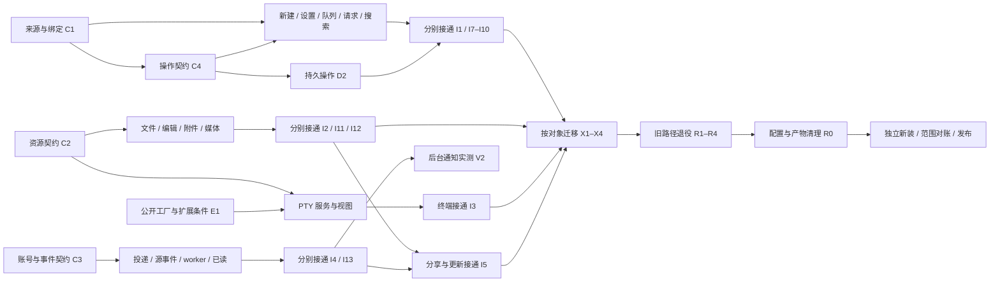

# HHPI 开发任务并发 DAG

状态：2026-11-08，配套主计划第十次修订。此前实施未完成，产品开发暂停；当前调整执行方案。目标仍为删除 HAPI 兼容来源、保持 HHPI v1、完成三条原生来源的完整工作台。这里把原有三条固定分工改为动态任务队列；原角色表只用于减少上下文切换，不再限制任务领取顺序。

[主计划](hhpi-product-change-plan-2026-11-07.md)定义产品范围，[交付方法](hhpi-delivery-method.md)定义验证与审阅规则；本文件定义谁在什么条件下可以继续。详细节点、前置边、文件写入集合、外部条件和范围映射以[任务数据 JSON](hhpi-development-dag.json)为准；[完整 Mermaid 图](hhpi-development-dag.mmd)由同一数据生成。它们是计划附件，不是新建的调度框架。

## 1. 并发目标和代码依据

实际领取和记录可使用[开发 profile 工具](development-profile-rsi.md)，直接读取同一份 DAG JSON，检查依赖、gate、文件互斥和四槽上限。工具不会自行启动子代理；主 Agent 用既有委派工具执行就绪任务。

目标是缩短完整可用版本的交付时间，并让已就绪、互不冲突的实现工作保持推进。拆得更细会增加交接；一个节点应能交付明确接口、一个有局部证据的组件、一个真实接通的用户动作，或一个必要的迁移/验收结果，不按函数数量机械拆分。

基线为 `81620088ed78bf0c34a71a70e6067ed9de8c5cb8`、DSH `0.2.2-rc.1`。本次定点阅读了 Host/客户端组合根、来源与操作边界、工作区类型、通知/read-sync 及固定版本 PTY owner 组合；核对任务中现有文件确实存在。没有重新全量审计源码，也没有验证实际运行状态。后续新增位置是建议命名，代码尚不存在。

当前几个确定的并发限制来自实际代码：

- `src/index.ts`、`src/client/index.ts`集中注册原生任务、文件、终端和应用服务，多条工作流会同时要求修改；由集成负责人串行处理。
- `src/client/remote-sessions.ts`连接能力、正文、操作和 Pane，不让多个子代理同时重写；业务模块可以先按明确契约实现。
- `src/workbench-types.ts`与`src/shared/source-access.ts`影响文件和终端，先形成 C2，F/T 分支随后各自推进。
- DSH `TerminalController`仍从 `agent.ctx`取得生命周期、subprocess 和沙箱上下文，T1 的公开组合/扩展条件由 E1 处理；文件服务不等待它。
- 通知、更新和分享仍有旧来源耦合，按账号/事件契约 C3 分拆 N 分支；它们不等待完整任务 UI。

## 2. 图中两种约束必须分开

**硬依赖边**表示后继必须取得前驱交付物，例如 C2 的资源契约、D2 的持久操作基础。**资源互斥**表示两个任务虽然功能独立，却不能同时写同一文件、占用同一设备或替换被检查的运行版本。互斥不写成任意先后关系，避免人为延长依赖链。

契约节点完成只释放组件开发。局部 fixture 通过只证明对应组件行为；真实接通由 I 节点确认。接口就绪、组件实现、源端实际完成三个状态分别记录，不能把待接通的菜单注册成已经可用。

下面是分支概览，省略部分依赖；精确边见任务表及 JSON。

## 3. 动态领取任务，而不是固定三条流水线

运行上限按当前环境为一个主代理加三个 Codex 子代理；主代理按派工、冲突和交付事件介入；其余时间等待原生代理事件。集成由路径负责人承担。A/B/C 是上下文偏好，不是岗位占位：文件任务等待时，该代理可以领取终端、迁移或已读任务；没有独立实现内容时不为凑数量另开代理。

派发规则如下：

1. 所有硬前驱已有对应交付物，开始条件满足，且精确写入范围已经确定，才进入可运行集合。只有验收条件未满足的任务可以先做其实现部分，随后记录为“实现完成、等待条件”，释放名额；不能标为整项完成来放行退役。
2. 从可运行集合中选互不冲突的任务，最多占用四个名额，其中至少保留主代理的协调职责。先处理能解除外部等待或释放多条后续分支的短任务，再考虑剩余最长依赖链；同等条件优先复用已经熟悉的上下文。实际耗时逐渐可得后更新顺序，不声称这是全局最优调度。
3. 每个写入文件只有一名负责人；测试/helper/config 新增修改也要加入同一范围。未列出的共享文件先交主代理或明确移交，不让两个代理靠口头同步覆盖修改。退役文件和上游扩展文件由 X0/E1 的精确 manifest 补齐，未补齐不放行相关写入。
4. 子代理完成入口接通、改动和对应路径验证后，主代理按完成事件消费结果并派发下一条路径。I1 新建完成不等 I8 计划；I3 终端不等 I2 编辑；I4 通知不等任务 UI 或文件。集成节点自身修改很小，业务实现留在对应组件节点。
5. 每个功能切片仍触发必要的独立查漏；使用已释放的名额和独立上下文，复用证据。V3 只汇总并补查剩余缺口，不把所有审阅推迟到最后，也不另起常驻审阅团队。

第一批可并行做 B0（主代理）、E1、E2；B0 后立即放行 C1/C2/C3/X0/S1，按空闲名额选择，主代理也可承担一个契约节点。C1 完成便可做 C4、A5、A6、H3、L2，不等 C2/C3。C2 完成便可做 F1/F2/F5/T2；C3 完成便可做 N1/N3。C4 完成后 D2 与 A1–A4 可开始；相应的 C2/C3 也就绪时，F3/F4/N6 同样可开始。这里描述事件驱动的就绪关系，不要求整批结束才发下一批。

例如 C1–C4 就绪时，`D2 + F3 + T2 + N1` 的已列写入文件互不相交，可由主代理及三个子代理同时实现；终端尚缺扩展批准时仍可先做 T2 的已有公开客户端部分。局部测试开始前需额外稳定其读取的共享依赖，不能由文件写入不相交推断测试天然隔离。

## 4. 任务清单

每个组件节点都包含自己的定向验证和受影响 UI 检查。I 节点负责真实接线与用户结果，不再重复编写组件。表中的前驱只有硬依赖，未列的共享写入仍受第 5 节限制；全部当前状态为计划中。节点 ID 与产品要求编号不是同一套编号，例如任务 R1 承担主计划退役要求 R2/R3/R4，见第 7 节的映射。

### 准备

| 节点 | 交付物与关闭依据 | 硬前驱 | 执行者 / 条件 |
| --- | --- | --- | --- |
| **B0** 固定基线与任务写入归属 | 核对最新用户目标、当前 diff、既有批准与公共文件负责人；先保存生命周期/组合行为及关键假设，再对照旧清单，复用现有记录。 验证：用户决定、验证事实和设计假设分开；新增目标内必要行为有归属，不能用原 64 条映射宣称完整。 | 无 | 主代理 |
| **E1** 确认 PTY 公开组合与扩展边界 | 核对固定 DSH 版本的 owner/context 工厂；明确现有公开组合可用，或列出所需包与最小扩展及已有批准。 验证：明确 T1 的扩展条件；未批准不得改上游源码。 | 无 | 空闲代理 |
| **E2** 准备手机与后台通知验证条件 | 发现实际设备、浏览器、IME、隔离账号/会话、推送环境及现有设备验收规则；准备不等于通过。 验证：G_DEVICE、G_PUSH、G_DEVICE_BUDGET 分别记录有据结果；无条件保持待处理。 | 无 | 空闲代理 |
| **X0** 精确盘点迁移对象和退役文件 | 产出 R1–R10 的实际引用/注册/产物与数据去向清单，按会话、文件、PTY、应用服务分四份退役 manifest。 验证：每份列确切文件和保留消费者；不按目录名删除，不写私密数据。 | B0 | 空闲代理 |

### 契约

| 节点 | 交付物与关闭依据 | 硬前驱 | 执行者 / 条件 |
| --- | --- | --- | --- |
| **C1** 来源能力与绑定契约 | 固定本机 DSH、federation、Codex 的 capability/binding/provider 输入输出及 unavailable 原因。 验证：类型与最小契约检查；HHPI v1 不变。 记录本契约关键假设及可推翻它的组合场景。 | B0 | 空闲代理 |
| **C2** 源工作区与文件资源契约 | 确定源机器、授权、文件版本、流式上传和 PTY owner 的内部服务边界；禁止落回中央 Host。 验证：只读默认契约保留；不新增 HHPI v1 字段。 记录本契约关键假设及可推翻它的组合场景。 | B0 | 空闲代理 |
| **C3** 账号、通知与阅读状态契约 | 确定应用服务的账号/设备/源身份、事件位置、阅读意图、订阅及分享范围。 验证：跨账号隔离与旧请求身份的契约可检查。 记录本契约关键假设及可推翻它的组合场景。 | B0 | 空闲代理 |
| **C4** 持久操作及结果关联契约 | 明确 settings/fork/plan/queue 的意图、认领、receipt 与源结果关联；文件保存、PTY 不共用消息重发。 验证：使用既有事务与主键；接受、源确认、结果分别建模。 记录本契约关键假设及可推翻它的组合场景。 | C1 | 空闲代理 |

### 基础

| 节点 | 交付物与关闭依据 | 硬前驱 | 执行者 / 条件 |
| --- | --- | --- | --- |
| **D1** 实现能力解析与目录共享 | 按来源和代际共享能力/模型/技能目录，原生入口选择同一 provider。 验证：菜单不恢复执行；能力、在线、授权分别表达。 | C1 | 空闲代理 |
| **D2** 扩展操作账本及源结果持久化 | 先接已有操作，再支持新设置、分支和计划动作；丢回执查询原 ID，保留不明结果。 验证：多 Pane/重载/撤销/源已执行但回执丢失；不重建线程或盲目重发。 | C4 | 空闲代理 |
| **D3** 接通源工作区执行与授权环境 | 在确切机器组合源工作区服务；复用远端访问授权及执行环境，不创建替身 Agent。 验证：同名路径跨机器不混淆；服务端拒绝越权及 Host 回退。 | C2 | 空闲代理 |

### 任务

| 节点 | 交付物与关闭依据 | 硬前驱 | 执行者 / 条件 |
| --- | --- | --- | --- |
| **A1** 新建与分支完整交互 | 从入口收集来源/目录，拿确切新目标后打开，返回父会话保留草稿；提供待确认恢复入口。 验证：契约 fixture 可用于局部检查，真实原生关联由 I1 关闭。 | C1, C4 | 空闲代理 |
| **A2** 设置、命令和候选统一处理 | 菜单、斜杠、模型/权限、技能和插件引用使用同一动作语义与绑定。 验证：取消菜单保留光标和草稿；来源切换后迟到结果不串对象。 | C1, C4 | 空闲代理 |
| **A3** 队列、计划与 Goal 操作 | 接完整队列编辑/取消、计划执行/继续规划、Goal 与 Todo 各自语义。 验证：开始与编辑竞争、原 ID 恢复、不可用原因及相邻入口一致。 | C1, C4 | 空闲代理 |
| **A4** 审批和结构化问题呈现 | 请求卡展示人可判断的内容与动作，技术详情收起，保留精确 request/turn。 验证：多待处理、旧卡、自由回答、源结算和不支持处理器不误批准。 | C1, C4 | 空闲代理 |
| **A5** 过程、正文和富结果分层 | 保留当前过程展开、历史收起和手动意图；正文、计划、图片、错误不被吞。 验证：运行→正文→新过程→图片/计划→完成；受控源说明按既有指令入口处理。 | C1 | 空闲代理 |
| **A6** 来源搜索及父子任务导航 | 接真实搜索、已有分页、父子任务历史/终态和精确返回。 验证：不按标题猜目标，不将全量 catalog 称为 wire 分页。 | C1 | 空闲代理 |

### 文件

| 节点 | 交付物与关闭依据 | 硬前驱 | 执行者 / 条件 |
| --- | --- | --- | --- |
| **F1** 独立源文件读写与版本保护 | 提取通用源文件服务，涵盖目录、搜索、读写、管理动作、版本/冲突与授权。 验证：真实写入在隔离源工作区；读后写不冒充任意外部进程原子 CAS。 | C2 | 空闲代理 |
| **F2** 文件浏览、管理和返回入口 | 从树、搜索、Diff 进入原对象，管理操作逐项反馈，引用后回到原草稿。 验证：错误目标、部分成功、取消/返回、只读授权和迟到读取。 | C2 | 空闲代理 |
| **F3** 编辑保存与脏稿恢复 | 编辑、保存、冲突、外部变更和多编辑视图保留各自脏稿及光标。 验证：保存期间继续输入、丢回执、刷新恢复，不覆盖新输入。 | C2, C4 | 空闲代理 |
| **F4** 附件本机准备与二进制传输 | 保持选图即启动上传；内部先本机处理再传输，普通文件也可进度/取消/恢复。 验证：常见照片、长图、源码和文档；移除与迟到完成不串附件。 | C2, C4 | 空闲代理 |
| **F5** 媒体预览、下载与引用 | 声明支持的媒体/文档可读、可播放或取得原件；相对链接、选区引用与返回完整。 验证：格式失败仍能取原件；不自动发送；布局与实际媒体另给证据。 | C2 | 空闲代理 |

### 终端

| 节点 | 交付物与关闭依据 | 硬前驱 | 执行者 / 条件 |
| --- | --- | --- | --- |
| **T1** 源 owner 的公开 PTY 组合 | 接 DSH 真 PTY 生命周期、保留、恢复、ack 与单输入控制权；只在确需时修改已批准的公开工厂。 验证：不伪造 Agent.ctx；不改 terminal wire；无原进程时明确结束。 | C2, E1 | 空闲代理；开始前 G_EXT |
| **T2** 终端视图与手机控制入口 | 复用原生终端 UI，处理 attach/read-only/断线、控制键、粘贴、resize 和返回。 验证：局部输入/控制检查；原进程恢复由 I3、真机键盘由 V1 关闭。 | C2 | 空闲代理 |

### 应用

| 节点 | 交付物与关闭依据 | 硬前驱 | 执行者 / 条件 |
| --- | --- | --- | --- |
| **N1** 账号隔离的订阅与投递服务 | 实现自有 Host 订阅保存/撤销、投递状态及渠道重试；密钥只在服务端。 验证：账号切换、过期、撤销与服务重启；不得重发 Agent 操作。 | C3 | 空闲代理 |
| **N2** 无 Pane 时的轻量源事件观察 | 消费已授权源事件，按身份维护有界游标和缺口恢复；不保留完整 transcript/DOM。 验证：初始基线/重连不重推旧完成，来源撤销终止观察。 | C1, C3 | 空闲代理 |
| **N3** 通知设置、worker 与精确跳转 | 去除 legacyHapi 门控，登录后继续原通知目标，旧请求不绑定新请求。 验证：投递、展示、已读分别表达；拒绝权限与重订阅可继续。 | C3 | 空闲代理 |
| **N4** 跨设备已读与手动未读 | 持久化账号/源会话阅读意图，接原生读者提交；迟到快照不撤销新意图。 验证：打开列表/后台收到不自动已读；跨设备冲突收敛。 | C1, C3 | 空闲代理 |
| **N5** 独立分享、导出与接收 | 通用分享与富内容导出脱离 Hub，资源范围授权和认证后返回完整。 验证：引用实际资源可读；失效链接、跨账号和返回原草稿。 | C1, C2, C3 | 空闲代理 |
| **N6** 安装更新与多类草稿 checkpoint | 更新前统一调用消息/附件/文档/位置 checkpoint，失败留在当前版本，不新建执行。 验证：局部失败与延迟；真实对象接线由 I5 验证。 | C3, C4 | 空闲代理 |

### 连续性

| 节点 | 交付物与关闭依据 | 硬前驱 | 执行者 / 条件 |
| --- | --- | --- | --- |
| **H1** 核对重开窗口缺口与阅读基线 | 复核已定位的旧缓存/全局追赶耦合；固定视口和 N，比较 Δ=0/1000/10000 的默认 latest、显式 around、重放可用/过期路径。 验证：分别记录首屏读取与独立同步、请求量/字节/驻留、就绪时间及当前 80 ms 结果；已有证据可复用，不从零调查。 | B0 | 空闲代理 |
| **H2** 分离目标窗口读取与同步追赶 | 默认重开直接 latest 取 N 条；显式继续旧位置/搜索走 around；修复缓存尾部事实，窗口就绪不等待全量正文追赶，保留版本/代际/多读者和写入对账。 验证：覆盖 Δ/N、冷暖缓存、重放过期、双 Pane/修订/pending 写入；首屏与驻留受窗口预算约束，后台量单列；保留连续阅读及相关故障保护。 | C1, H1 | 空闲代理 |
| **H3** 导航、紧凑输入与次级页面修复 | 核查 Pane/返回、长按、紧凑输入和通用设置；修明确缺陷，不再重做编辑器。 验证：真实菜单取消/返回/长草稿/窄屏；真机结论由 V1 取得。 | C1 | 空闲代理 |

### 迁移

| 节点 | 交付物与关闭依据 | 硬前驱 | 执行者 / 条件 |
| --- | --- | --- | --- |
| **L1** 离线迁移公共读取与恢复包 | 实现只读输入快照、精确身份索引及离线恢复包基础；按对象交接，不装入产品运行时。 验证：重复运行、中途失败、无映射内容可访问；禁止按标题猜身份。 | X0, C1, C2, C3, C4 | 空闲代理 |
| **L2** 原生运行时精确别名解析 | 实现仅消费当前格式和精确本地别名的解析；别名不替代来源授权。 验证：旧链接能到确切原目标；未知映射保留内容，不访问 Hub。 | C1 | 空闲代理 |
| **X1** 会话、owner、队列和草稿转移 | 实现并演练精确会话/队列转换；按来源结算旧写入 owner，未知结果留待确认，随后切换唯一可写路径。 验证：隔离升级快照可重复恢复；实际旧 owner 未退出时不得关闭该来源迁移。 | L1, L2, I1, I7, I8, I9, I10 | 空闲代理；关闭前 G_OWNER |
| **X2** 文件、附件和编辑草稿转移 | 转换真实二进制对象、receipt、文档脏稿及冲突基线；未映射原件保留离线可访问副本。 验证：刷新、部分失败、缺附件、重复转换；不能只迁 metadata。 | L1, I2, I11, I12 | 空闲代理 |
| **X3** 旧 PTY 退出与输出保留 | 盘点旧 owner/进程，只有确切受支持 attach 才复用；否则保留输出并等待有据的退出条件。 验证：不创建新 shell 冒充迁移，不强停无关进程。 | L1, I3 | 空闲代理；关闭前 G_PTY_EXIT |
| **X4** 布局、已读、订阅和应用设置转移 | 转换布局、阅读与手动未读；按 origin/key/账号条件重新绑定订阅，保留通知选择。 验证：旧账号隔离、旧完成不批量推送、无法精确定位时保留旧信息。 | L1, L2, I4, I13, I5 | 空闲代理 |

### 集成

| 节点 | 交付物与关闭依据 | 硬前驱 | 执行者 / 条件 |
| --- | --- | --- | --- |
| **I0** 稳定共享组合入口 | 先固定共享装配约定与现有任务 facade；资源和应用服务各自在 C2/C3 就绪后接线，不等全部契约或业务实现。 验证：未接通能力不冒报；默认原生 DSH 路径仍可用。 | C1, C4 | 主代理 |
| **I1** 接通新建与分支 | 正常入口创建或分支后进入确切原生线程，父草稿保留，未知结果可恢复。 验证：三条来源；确切源关联、原生首次提交、丢回执和返回；fixture 不关闭真实接通。 | I0, D1, D2, A1 | 主代理 |
| **I2** 接通文件浏览、管理与编辑 | 组合源文件服务、浏览管理页面与编辑器；正常入口保存并从正确源读回。 验证：两台同名路径源；创建/改名等管理动作、保存冲突、刷新脏稿及返回。 | I0, D1, D2, D3, F1, F2, F3 | 主代理 |
| **I3** 接通独立可靠终端 | 注册真实 PTY provider 与视图；此节点不依赖文件编辑完成。 验证：源 owner 存活时同进程恢复、不重放按键；关闭 Pane 不杀进程；显式关闭只结束原终端。 | I0, D1, D3, T1, T2 | 主代理 |
| **I4** 接通无 Pane 的后台通知 | 无目标 Pane 时由 Host 观察授权源，订阅/投递/认证后返回接通；不等待文件编辑。 验证：重连、撤销、旧请求和账号隔离；实际后台投递由 V2 关闭。 | I0, D1, D3, N1, N2, N3 | 主代理 |
| **I5** 接通分享和更新恢复 | 接真实资源授权、分享接收和所有 checkpoint 提供者，解除安装/更新门控。 验证：真实消息/附件/文档/阅读位置更新恢复；分享资源跨账号限制。 | I0, D2, I11, I12, I4, I13, N5, N6 | 主代理 |
| **I6** 接通重开定位与连续阅读 | 接通 latest/继续旧位置/搜索与通知目标，核对两个 Pane、媒体和导航；完整窗口可读与同步对账分别结算。 验证：复用 H2 组合回归，在既有预算确认重开目标及六段上翻/锚点/图片/帧间隔；独立首轮审查不得先沿用实现者清单。 | I0, H2, H3, I10, I12 | 主代理 |
| **I7** 接通设置、命令和候选 | 正常菜单和命令走同一原生 handler/ledger。 验证：模型、权限、技能/插件引用和菜单取消，结果与真实源一致。 | I0, D1, D2, A2 | 主代理 |
| **I8** 接通队列、计划和 Goal | 正常入口完成队列编辑/取消、计划执行/继续规划及原生 Goal。 验证：竞争、重载和多 Pane 不重复派发，源终态正确展示。 | I0, D1, D2, A3 | 主代理 |
| **I9** 接通审批和结构化问题 | 请求卡实际作用于原 request/turn 并跟随源结算。 验证：旧卡、多请求、答案草稿及可信处理器，不能误批准。 | I0, D1, D2, A4 | 主代理 |
| **I10** 接通搜索、父子导航和过程 | 真实搜索和父子导航落到确切任务，过程/正文/结果按语义呈现。 验证：搜索定位、返回位置、当前展开/历史收起和手动意图。 | I0, D1, A5, A6 | 主代理 |
| **I11** 接通附件传输与源端读取 | 原生附件入口完成本机准备、真实源上传、移除和提交。 验证：大图/文档读取、切 Pane/刷新/取消；没有中央 Host 回退。 | I0, D1, D2, D3, F1, F4 | 主代理 |
| **I12** 接通媒体、下载和引用返回 | 历史和新结果都可查看原件、下载、引用并返回。 验证：真实媒体、相对链接、选区引用与错误退路。 | I0, I2, A5, F5 | 主代理 |
| **I13** 接通跨设备阅读意图 | 原生读者提交与 Host 持久阅读/未读意图接通。 验证：跨账号隔离，跨设备迟到状态不撤销新意图。 | I0, D1, D3, N4 | 主代理 |

### 退役

| 节点 | 交付物与关闭依据 | 硬前驱 | 执行者 / 条件 |
| --- | --- | --- | --- |
| **R1** 退役会话、owner 桥和旧投影 | 按 SESSION manifest 提取仍有效 helper 后删除旧 owner 桥、伪会话、投影与管理 RPC；同步解除引用。 验证：R2/R3/R4 无生产可达路径；普通 DSH/federation/Codex 行为仍在。 | X1, I6 | 主代理 |
| **R2** 退役 HAPI 文件与 SessionTerminal | 按 RESOURCE manifest 删除旧文件/上传/终端后端及 slots；保留通用资源保护与 Codex 自身图片缓存升级。 验证：R5/R6 退出，原件、草稿、原生 PTY 仍可用。 | X2, X3 | 主代理 |
| **R3** 退役 Hub 应用服务和在线迁移 | 按 APPLICATION manifest 删除 Hub 通知/read-sync/分享及在线旧格式解析，装入精确别名读者。 验证：R7/R9 退出；迁移工具不装入生产包，无启动时 Hub 扫描。 | X1, X2, X4 | 主代理 |
| **R4** 移除 HAPI 专属入口 | 按 ENTRY manifest 删除 Hub 管理/备份、Companion、专属凭据语音入口；保留通用设置/导出/本地语音。 验证：R8 退出，旧链接有明确恢复路径；普通语音、设置取消和返回仍有效。 | X1, X3, X4 | 主代理 |
| **R0** 关闭组合根、配置与生产打包 | 删除 config.hapi 和 HAPI 专属依赖/export/注入/安装路径；v1 legacyHapi 固定 false，保留兼容字段定义。 验证：R1/R10 关闭；按实际导入/产物核对，不能靠字符串计数或改名；保留许可证及有效通用测试。 | R1, R2, R3, R4 | 主代理 |

### 交付

| 节点 | 交付物与关闭依据 | 硬前驱 | 执行者 / 条件 |
| --- | --- | --- | --- |
| **O1** 同步安装、定位、许可和运行说明 | 更新三条来源、独立服务、配置迁移、版本、通知/设备支持与回退说明；记录复用许可证。 验证：已有批准无需重新索取；新包扩展依赖和原生权限说明准确。 | R0 | 空闲代理 |
| **V0** 无 HAPI 新装与升级闭环 | 用隔离新装及升级快照走原生工作台，核对运行注册和网络访问无 Hub 依赖。 验证：复用安装/进程内检查；三条路径与用户数据保护，输出对应版本和未完成项。 | R0, I5, I6, X1, X2, X3, X4 | 空闲代理 |
| **V1** 实际手机键盘与终端验收 | 在实际支持的设备/IME 检查组合输入、候选、长草稿附件、菜单、方向切换、终端控制键与返回。 验证：记录设备/浏览器/输入法/构建；发现明确问题交回所属任务，保持该节点未通过直至复验。 | E2, I1, I7, I2, I11, I3, H3 | 空闲代理；关闭前 G_DEVICE, G_DEVICE_BUDGET |
| **V2** 实际后台通知与精确返回验收 | 隔离源产生事件，实际退后台接收并认证返回原请求，确认其他设备已读收敛。 验证：API 成功和前台 toast 不算通过；拒绝/撤销、旧通知、服务重启范围如实记录。 | E2, I4, I13 | 空闲代理；关闭前 G_DEVICE, G_PUSH, G_DEVICE_BUDGET |
| **V3** 独立查漏及全部范围对账 | 汇总各切片从原始目标独立推导的行为与首轮记录；核对 A1–P4/R1–R10、追加缺口、被推翻假设、二级状态和历史执行结论。 验证：复用切片证据；未查/失败不填通过；新必要行为回交负责人，同路径复验。测试分数、角色数量与目录映射均不证明完整。 | V0, V1, V2, O1, S1 | 空闲代理 |
| **V4** 最终统一发布与结果结算 | 在稳定代码上调用现有完整发布入口，核对实际线上版本与用户结果，保留回退；未完成项不能报整体完成。 验证：发布保护完整，UI/真机/原生证据对应最终版本；仅受影响结果需复验。 | V3 | 主代理 |

### Harness 改进

| 节点 | 交付物与关闭依据 | 硬前驱 | 执行者 / 条件 |
| --- | --- | --- | --- |
| **S1** 固定完整用户路径与独立行为判据 | 复用 profile 和现有检查，从用户目标确定入口、操作、结果与恢复。 验证：在候选调优前保存期待结果和材料来源；旧重开/附件问题不冒充主动新发现；检查器不由候选修改，关键资料由独立审阅形成。 | B0 | 主代理 |

S1 在 B0 后准备本批用户路径判据；S2 对照实验已取消，不再是 V3 前置条件。保留实际路径检查和必要的独立审阅，复用已有证据，不运行额外候选模型任务。

## 5. 文件归属、验证和发布互斥

JSON 为每项记录 `write_files`、`new_files`、`read_files`、`retirement_manifests`及`exclusive_resources`。现有文件已核对存在；`new_files`只是候选位置。`read_files`标记本次已知的关键参考，不是完整静态依赖闭包；测试时仍按现有选测器和实际导入确定稳定读取范围。

| 资源 | 谁使用 | 约束 |
| --- | --- | --- |
| 公共组合文件 | I0、各 I 接线节点及 R 退役节点 | 主代理串行修改；普通组件节点继续写自己的文件。需要临时转交时明确唯一新负责人 |
| `client/menus.ts` | H3、R4 | 两者没有硬依赖，可选先后，但不能同时写；R4 后再做 H3 时不得恢复旧入口 |
| 退役 manifest | R1–R4、T1 的条件扩展 | X0/E1 明确确切文件及保留消费者；把这些文件并入占用集合后再派发，不依据目录前缀直接删 |
| 局部验证 | 任一实现节点 | 检查期间暂停其读取文件和共享依赖的写入；通过结果记录代码范围，后续受影响变化使该结果失效 |
| 完整检查与安装 | V0、V4、增量发布 | 对共享 checkout 暂停所有产品写入；只读审阅和文档工作可继续。不在持续变化的工作区上宣称通过 |
| 已安装运行版本、浏览器与性能环境 | H1、I6、V1、V2、发布 | 按资源预约，固定构建版本；发布不能在检查中途替换它；性能检查串行 |
| 实际手机 | V1、V2 | 使用同一设备时串行；只有实际存在独立设备/账号环境才允许拆开，不假设已有两台可用手机 |
| 发布与依赖变更 | 主代理、R0、V4 | 单一发布者；不由子代理安装不同依赖、重启共享 Host 或分别跑完整发布 |

共享 checkout 下保留以上写入和读取限制，不自动创建 worktree。独立工作区的实验收益不能用于声称当前安排已经物理隔离。下游需要修改前驱契约时，先说明影响并调整相关节点，不让后续任务静默覆盖已验收的契约。

## 6. 外部条件只阻塞相关分支

| 条件 | 影响节点 | 满足方式 |
| --- | --- | --- |
| G_EXT | T1 涉及上游源码的部分 | E1 证明现有公开组合足够，或确认所需包/契约已经明确获批。未获批时继续其他任务，不能推定授权，也不重复询问同范围既有批准 |
| G_DEVICE | V1、V2 的实际验收 | Agent 找到可用物理设备及控制方式，记录平台/浏览器/IME。桌面视口不替代；环境准备不占住执行名额等待 |
| G_PUSH | V2 | 实际隔离推送环境、设备订阅和授权源事件就绪；凭据不写入文档 |
| G_DEVICE_BUDGET | V1、V2 | 主计划第 8 节拟新增设备检查具有明确适用规则和预算；复用已有授权，不能把新增检查塞进已经占满的两条浏览器场景 |
| G_OWNER | X1 的来源切换关闭 | 对该来源结算旧任务和请求，只有受支持交接或自然结束才切唯一 writer；转换工具和隔离演练可以先完成 |
| G_PTY_EXIT | X3 的旧终端退出关闭 | 精确可支持 attach，或原终端已自然结束/显式处理；不得新开 shell 冒充恢复或强停用户命令 |

这些条件目前未验证；不是本轮向用户发出的批准请求。实际执行中只处理确实缺少且影响下一步的条件，其余工作持续推进。来源级迁移可以逐项结算，但 R0 全局退出必须等待全部适用来源完成或有明确、不丢用户工作的解决结果。

## 7. 完整范围如何落到节点

A1–P4、M0–M8 和 R1–R10 均在 JSON 中逐项映射，结构检查确认引用的节点存在。该映射证明有责任归属，不证明产品已经实现或范围已经无遗漏。以下是便于阅读的分组索引：

| 范围 | 主要节点 |
| --- | --- |
| 实施组 M0 | X0, L1, L2, X1, X2, X3, X4, R1, R2, R3, R4, R0, V0 |
| 实施组 M1 | C1, D1, D3, I0 |
| 实施组 M2 | C4, D2, I1, X1 |
| 实施组 M3 | A1, A2, A3, A6, I1, I7, I8, I10 |
| 实施组 M4 | C2, D3, F1, F2, F3, F4, F5, T1, T2, I2, I3, I11, I12 |
| 实施组 M5 | A4, A5, I1, I9, I10 |
| 实施组 M6 | C3, N1, N2, N3, N4, N5, N6, I4, I5, V2, I13 |
| 实施组 M7 | H1, H2, I6 |
| 实施组 M8 | E2, H3, O1, V1, V2, V3, V4 |
| 开发方法与完整路径判据 | S1；跨层切片各自承担首轮独立审阅 |

| 主计划退役要求 | 任务节点 |
| --- | --- |
| R1 | R0 |
| R2 | R1 |
| R3 | R1 |
| R4 | R1 |
| R5 | R2 |
| R6 | R2 |
| R7 | R3 |
| R8 | R4 |
| R9 | R3 |
| R10 | R0, O1, V0 |

M7a 的最新/显式旧位置/定点窗口属于 L1–L4 的明确补充，H1/H2/I6 负责；S1 是开发方法任务，不伪装成新增产品功能。每条行为的真实完成仍看主计划的用户结果和执行记录。路径不适用须有固定来源/平台证据；不能通过删节点、把未接入记成不支持，或把用户已指出的问题留给 V3 才处理来压短依赖链。

## 8. 发布、失败与调度调整

I1/I2/I3/I4/I7–I13 中已经接通且可独立使用的切片，在所需独立查漏完成后可形成增量发布批次。批次必须包含其依赖闭包；当前 checkout 中若还有其他未完成写入，不立即发布混合状态。主代理先将这些在途修改收敛到明确可构建的完成边界，再短暂停写执行一次现有发布入口；如果某条在途分支无法及时收敛，就调整接下来派发的任务组合，不能用带未完成功能的构建换取并发数字。

V4 是整项计划的最终发布与结算，不是要求整个项目只发布一次。增量发布按事件插入，不把一个固定 release 节点串在每个小任务后；不能为每个子代理重复执行 `check`、`test:release` 和 `deploy`。正式发布保护保持完整，已验证切片及时发布。

V1/V2 可以提前在明确版本上发现问题，不等全部退役完才找手机或配置通知。若后续改动触及对应行为，原结果标记为需要复验，V4 只接受适用于最终版本的证据。节点失败时保留未完成状态，修复后只复验受影响部分；新发现的必要行为加入节点/依赖并更新同一记录。失败返工属于运行状态，不在静态 DAG 中画成循环，也不能自动无条件重发用户操作。

初始调度按解除外部依赖、释放后续工作和代码上下文安排；有实际耗时后再估计剩余关键路径。发现主代理因公共文件积压成为瓶颈，优先把业务逻辑留在独立模块、压短接线工作，并让主代理暂缓领取普通实现；不要再拆出需要更多共享修改的小任务。

## 9. 本轮结构检查与结论边界

当前图有 **65 个任务节点、173 条硬依赖边**，无环；所有节点均能到达 V4，64 条产品要求、9 个实施组和 10 个退役要求都有节点映射。已有文件路径与新增候选路径区分检查。

忽略文件互斥、外部条件和执行时长时，依赖图的最大反链宽度为 **29**；这只是潜在独立任务数，当前运行并发仍最多 **4**，不代表可以启动 29 个代理。

按节点数量的一条最长依赖链为：

`B0 → C1 → C4 → I0 → I2 → I12 → I5 → X4 → R3 → R0 → V0 → V3 → V4`

它含 13 个节点，但没有实测执行时长，不能称为真实耗时关键路径或据此承诺提速倍数。另识别了 93 对没有硬先后关系却共享已列写入文件的任务，主要是公共接线节点；它们由资源占用和主代理串行处理，而不是误认为可同时执行。后续 manifest 和测试文件补齐后重新计算冲突。

本次只验证计划的数据结构、路径、链接和范围映射，没有运行产品测试、浏览器、原生执行或物理设备验收。研究依据见[交付方法第 10–11 节](hhpi-delivery-method.md)，没有把基准论文的速度换算成本项目承诺。
