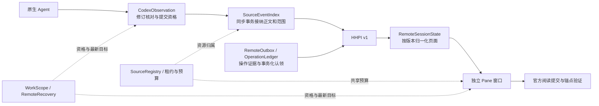

# HHPI 观察、对账和阅读所有权

本次重构保持 HHPI v1 的方法、字段和错误码集合不变，也不引入外部 AHP Host。借鉴的是 AHP/VS Code 的版本化事实、代际句柄、共享订阅和 confirmed/pending 分离。原生执行、排队和审批终审继续归原执行端；官方 DSH Conversation、windowCommit 和已有无变化更新优化保持接通。

## 四个职责

源端把 metadata、选中 item 的读取和最终提交分开。原生 item 修订在读取正文后再次核对；连接代际、所属 history、epoch、已提交 version 和观测资格共同决定候选能否提交。范围、坐标、item 修订及正文在一个 index.batch 中接纳。不同线程不共用 I/O 大锁。并发旧读失去提交资格，不能靠长文本前缀判断替代真实修订。已有前缀检查仍用于兼容缺少精细修订的原生通知。

客户端的 RemoteSessionState 保留有界连续增量日志，恢复中的每页从自身版本重放到同一目标版本，才合并为候选。断档不允许给旧内容贴新版本；重读一次仍无法覆盖时保留正式窗口并报告失败。目录信息是提示，可以收窄写权限和更新连接状态，不能回滚已接纳的正文、activeTurn、审批或标题。目录成员与 last-known 阅读记录分开投影，目录遗漏不表示授权撤销。

WorkScope 负责跨 await 的提交资格。RemoteRecovery 合并同一恢复目标，并在旧任务结束或失败后追赶最新 epoch/generation；旧错误不能终结新恢复。Pane 的导航和官方阅读提交仍有各自资格检查。

RemoteOutbox 现在保存 send、steer、cancel 和 approve 的不可变身份与原目标。同步 localStorage 日志满足官方输入的同步保存契约；派发前必须完成 IndexedDB readwrite 事务认领。已有 v1 send 在第一次认领时导入。发送前记录“可能派发”，重载后查询原 ID。receipt=null 和传输失败都不能授权重发；只有明确 retryable=true，且原目标仍有效，才允许继续同 ID 的请求。只读回执查询不受原目标已经结束的影响。控制请求不会离线自动派发到替代 turn；重载前尚未派发的控制需显式继续。

accepted、原 owner 的精确 durable admission、原生正文观察是不同证据。前者保留待确认回显；owner admission 的移交记录仍可查看原文，并明确不表示执行完成；只有接纳历史中的精确 rpcId 才完成原生回显对账。控制回执使用控制状态文案，不等待不存在的 user/message。控制 ID 从 session/kind/target 完整三元组派生：原生目标 ID 只在会话内唯一，而完整拼接可能超过现有 operationId 的 256 字符限制，因此派生为固定长度主键；这不是新增内容校验。

IndexedDB 终态记录阻止另一个标签页的迟到 ACK 复活本地意图，storage 事件同步显示。账户和来源撤销清除相应正文和操作载荷，并留下无正文终态。活跃消息、owner receipt 和历史窗口分别有预算；终态身份仍保留在数据库中，未引入可能让极晚回调再次认领旧操作的按时间删墓碑机制。

SourceRegistry 分别持有各来源目录、可用性、错误、刷新任务和下次刷新时间。生产目录刷新合并并设 15 秒冷却，原生 Codex 也保留自身发现缓存。全量 wire catalog 仍受原协议约束，没有宣称新增端到端分页。read/changes/resource 通过源端观察租约使用索引；没有读者时停止正文轮询，空闲 30 秒后关闭显示索引并可从持久状态重开，原生任务不受影响。客户端最后一个读者释放后保留 300ms 共享观察，快速重挂载复用；显式撤销立即释放。

单页接纳预算与源级总预算分开。预算内不裁已读正文；压力下按导航方向生成裁剪候选，保护显式依赖、请求页和其他 Pane。官方 windowCommit 继续验证当前 Pane 的读者和锚点；拒绝候选时保留原正式窗口。保护集本身超预算时拒绝扩张，不把固定消息组数当作安全策略。

## 缺口覆盖

| 问题 | 承担职责 |
| --- | --- |
| F1 恢复页混合版本 | RemoteSessionState 连续增量重放与统一版本合并 |
| F2 恢复被新 reset 替代 | RemoteRecovery 最新目标循环 |
| F3 跨代际 metadata 覆盖 | WorkScope、CodexObservation 提交资格 |
| F4/F5 steer 未知或 accepted 被当成 observed | 共享持久操作记录、精确正文对账 |
| F6 目录回滚事实 | 版本化观察与目录提示分离 |
| F7 跨标签页复活 | IndexedDB 认领、终态事务与 storage 显示同步 |
| F8 退订抖动 | 客户端 300ms 最后释放防抖 |
| G0 同代际并发正文回滚 | 提交资格及原生 metadata/item 修订二次核对 |
| G1 活跃窗口突破预算 | 源级保护集和候选裁剪、官方提交校验 |
| G2 空闲显示索引与轮询 | 观察租约、30 秒空闲关闭与持久重开 |
| G3 删除后仍通告 | 显式 native deletion 退目录，last-known 与通告分离 |
| G4 能力错误被当撤销 | ACL 走已有 remote-access/denied；读能力不足映射现有 HISTORY_UNAVAILABLE；旧 Host 的歧义 UNSUPPORTED 保持 fail-closed |
| G5 目录全扫描 | 来源级任务合并与刷新冷却；wire 分页不在本次协议范围 |
| G6 接口存在被当能力 | source-operation-policy 显式检查 send/steer/cancel/approve 的原目标；其余 SessionFace 能力继续原委派或明确拒绝 |

未知 create 的 wire 契约没有客户端 receipt lookup，本次继续保留原身份并报告不确定，不能猜测会话关联或盲目重建。数据和实现错误不再统一伪装成暂时断网；来源的 SourceError 及既有 carrier 错误按其本义传播。

## 验证与性能边界

新增竞态用例从原 F1–F7 生产代码复现转为修复断言，另覆盖同代际竞争、明确删除、跨 Pane 压力和空闲索引租约。`node scripts/test-operation-transactions.mjs` 在隔离的合成 HTTP origin 中使用真实 Chromium/IndexedDB 验证两个标签页的派发认领、空回执不重发和迟到 ACK；不连接生产 Agent。jsdom 的展示测试显式使用内存事务边界，不冒充真实 IndexedDB。

变更增加有界增量日志、操作事务和发生正文读取时的 metadata 二次核对；减少空闲正文轮询、目录扫描和快速重挂载退订。未给出未经对照测量的百分比提速。已有无变化 publication、metadata 快照复用和官方布局批处理继续保留。发布仍须通过原有完整检查、两条真实历史阅读场景及 80ms 帧间隔门槛。
